# Scalable Web Application Infrastructure on AWS

A highly available, auto-scaling web application platform on AWS: EC2 instances in private subnets behind an Application Load Balancer, a Multi-AZ RDS database, and a three-tier VPC spread across two Availability Zones. Built and documented step by step in the AWS console.

**Key services:** VPC, EC2 Auto Scaling, ALB, WAF, RDS Multi-AZ, CloudFront, Route 53, Systems Manager (Session Manager), CloudWatch, SNS.

**Design goal:** Survive the loss of an instance or a whole Availability Zone with no manual action, keep everything except the load balancer off the public internet, and scale with demand.

## Table of contents

1. [Overview](#1-overview)
2. [Architecture](#2-architecture)
3. [Design decisions](#3-design-decisions)
4. [Build](#4-build)
5. [Testing and validation](#5-testing-and-validation)
6. [Cost and cleanup](#6-cost-and-cleanup)
7. [Improvements](#8-improvements)

---

## 1. Overview

This project deploys a production-style web application on AWS and explains every choice behind it, including the options I rejected.

**What it does**

- Serves a web application from EC2 instances managed by an Auto Scaling group across two Availability Zones.
- Distributes traffic with an internet-facing Application Load Balancer protected by AWS WAF.
- Stores data in an RDS Multi-AZ database with automatic failover.
- Keeps all compute and data in private subnets. Outbound traffic goes through NAT Gateways, and administrators connect with Session Manager (no bastion host, no SSH).
- Caches static assets at the edge with CloudFront and provides a Route 53 private hosted zone with an alias record to the ALB, plus a health check.
- Monitors the platform with CloudWatch dashboards and alarms, with notifications through SNS.

**What it demonstrates**

- Designing a VPC with correct subnet, route table and NAT Gateway configuration.
- Building high availability across multiple Availability Zones.
- Configuring ALB listener rules and target group health checks.
- Auto Scaling with target tracking.
- Layered security: WAF, security group chaining, private subnets, no inbound SSH.

**Assumptions and scope**

- **Region:** eu-west-3 (Paris). Every resource uses the prefix `saa-web-`.
- **No domain name.** Buying one only for this project was not worth the cost, so there is no public DNS name and no ACM certificate. The ALB is reached through its generated DNS name, CloudFront through its `*.cloudfront.net` name, and Route 53 is used as a **private** hosted zone (`saa-web.internal`) that resolves only inside the VPC.
- **Static application.** The instances serve a small nginx page that shows their own instance ID and Availability Zone. The application does not read from or write to the database: the database is deployed and protected as it would be in production, but application-to-database traffic is not exercised by this project.
- **Built manually in the AWS console.**
- **Cost controls:** two AWS Budgets ($5 and $10) were created before building anything.

---

## 2. Architecture

### Request flow

1. **Name resolution:** users reach the ALB through its generated DNS name and CloudFront through its `*.cloudfront.net` name. Inside the VPC, a Route 53 private hosted zone resolves `app.saa-web.internal` to the ALB with an alias record. A Route 53 health check monitors the ALB.
2. **Dynamic request:** user --> Internet Gateway --> ALB (inspected by WAF).
3. **Static request:** user --> CloudFront edge cache.
4. **Cache miss:** CloudFront fetches the file from the ALB, then caches it.
5. **ALB to compute:** the ALB forwards to a healthy EC2 instance in either AZ through the target group.
6. **Data:** the RDS primary replicates synchronously to a standby in the other AZ, and the app tier is the only tier allowed to reach it on port 5432.
7. **Outbound only:** patches and SSM traffic leave through the NAT Gateway in the instance's own AZ.
8. **Admin access:** Session Manager, with no bastion and no port 22.

### Network plan

| Tier | AZ A (eu-west-3a) | AZ B (eu-west-3b) | Internet route |
|---|---|---|---|
| Public (ALB, NAT) | 10.0.0.0/24 | 10.0.1.0/24 | Internet Gateway |
| Private app (EC2) | 10.0.10.0/24 | 10.0.11.0/24 | NAT Gateway (same AZ) |
| Private data (RDS) | 10.0.20.0/24 | 10.0.21.0/24 | none |

VPC CIDR: `10.0.0.0/16`.

### Security group chain

| Group | Inbound |
|---|---|
| `saa-web-alb-sg` | TCP 80 from 0.0.0.0/0 |
| `saa-web-app-sg` | TCP 80 from `saa-web-alb-sg` only |
| `saa-web-db-sg` | TCP 5432 from `saa-web-app-sg` only |

---

## 3. Design decisions

| Decision | Why | Alternative rejected |
|---|---|---|
| Two AZs | Minimum for real HA, required by RDS Multi-AZ | Three AZs; multi-region (out of scope) |
| Three subnet tiers | Each tier gets only the access it needs, and the data tier has no internet route |  |
| EC2 in private subnets | Only the ALB is reachable from the internet | Public instances with strict security groups |
| Application Load Balancer | Layer 7, path routing, HTTP health checks, WAF support |  |
| WAF on the ALB | Managed rules against injection attacks on the dynamic path | WAF on CloudFront only (cached hits never reach the origin, and the ALB would stay unprotected) |
| Auto Scaling, min 2, target tracking | Replaces failed instances and scales on a simple metric target |  |
| Security group referencing | Rules follow the groups, not IP addresses |  |
| One zonal NAT Gateway per AZ | Outbound access survives an AZ failure and avoids cross-AZ traffic | One shared NAT (cheaper, but an AZ-level single point of failure) |
| S3 gateway endpoint | Free, and keeps S3-hosted traffic such as package repositories off the NAT | Sending everything through the NAT |
| Session Manager | No exposed port, no keys, sessions are logged | Bastion host or SSH |
| RDS PostgreSQL Multi-AZ with one standby | Synchronous standby and automatic failover, one endpoint for the app | Read replica; database on EC2 |
| CloudFront with the ALB as origin | Caches static files at the edge without adding S3 to the scope | S3 as origin |
| Route 53 private hosted zone with an alias to the ALB | No domain purchase, still shows alias records and health checks | Buying a domain (extra cost) |
| ALB listener on HTTP only | Without a domain there is no certificate, and an HTTPS listener cannot exist without one | |
| Default NACLs | Stateless NACLs are easy to misconfigure, and security groups provide the controls | |

---

## 4. Build

Region: **eu-west-3 (Paris)**. Each step follows the same template: **What**, **Why**, **Screenshots**, **Issues**.
### 4.1 Network foundation

VPC, subnets, Internet Gateway, route tables, NAT Gateways, S3 gateway endpoint.

#### What

- **VPC** `saa-web-vpc` with CIDR `10.0.0.0/16`. DNS resolution and DNS hostnames are both enabled.
- **Six /24 subnets** across two Availability Zones and three tiers:

| Subnet | AZ | CIDR |
|---|---|---|
| `saa-web-public-a` | eu-west-3a | 10.0.0.0/24 |
| `saa-web-public-b` | eu-west-3b | 10.0.1.0/24 |
| `saa-web-app-a` | eu-west-3a | 10.0.10.0/24 |
| `saa-web-app-b` | eu-west-3b | 10.0.11.0/24 |
| `saa-web-data-a` | eu-west-3a | 10.0.20.0/24 |
| `saa-web-data-b` | eu-west-3b | 10.0.21.0/24 |

- **Internet Gateway** `saa-web-igw`, attached to the VPC.
- **Two zonal NAT Gateways**, `saa-web-nat-a` in `public-a` and `saa-web-nat-b` in `public-b`, each with its own Elastic IP.
- **S3 gateway endpoint** `saa-web-s3-endpoint`, associated with both app route tables.
- **Four route tables**, each associated explicitly:

| Route table | Associated subnets | Routes |
|---|---|---|
| `saa-web-rt-public` | public-a, public-b | `local`, `0.0.0.0/0` to `saa-web-igw` |
| `saa-web-rt-app-a` | app-a | `local`, `0.0.0.0/0` to `saa-web-nat-a`, S3 prefix list to the gateway endpoint |
| `saa-web-rt-app-b` | app-b | `local`, `0.0.0.0/0` to `saa-web-nat-b`, S3 prefix list to the gateway endpoint |
| `saa-web-rt-data` | data-a, data-b | `local` only |

The main route table was left untouched, with only its `local` route.

#### Why

- **One NAT Gateway and one route table per AZ.** Each app subnet sends its outbound traffic to the NAT in its own AZ. If one AZ fails, the other keeps its outbound path, and traffic does not cross AZs, which avoids inter-AZ transfer charges. The trade-off is a second hourly NAT charge. I chose zonal NAT Gateways over the newer regional mode because they make the per-AZ routing explicit.
- **Outbound only.** A NAT Gateway only allows return traffic for connections that started inside the VPC. Nothing in the app subnets has a route from the Internet Gateway, and no instance gets a public IP, so there is no inbound path from the internet.
- **Main route table kept clean.** Any subnet that is not explicitly associated falls back to the main route table. With no internet route in it, a forgotten subnet stays private instead of being exposed by accident.
- **S3 gateway endpoint.** The application does not use S3 itself, but some AWS-managed traffic does, such as OS package repositories hosted on S3. Through the endpoint that traffic stays on AWS's network instead of passing through the NAT Gateways, which saves NAT data processing charges. Gateway endpoints are free, and I attached it only to the app route tables because that is where the instances live.
- **DNS settings.** Both settings are required for the Route 53 private hosted zone and for instances to resolve AWS service endpoints.

#### Screenshots

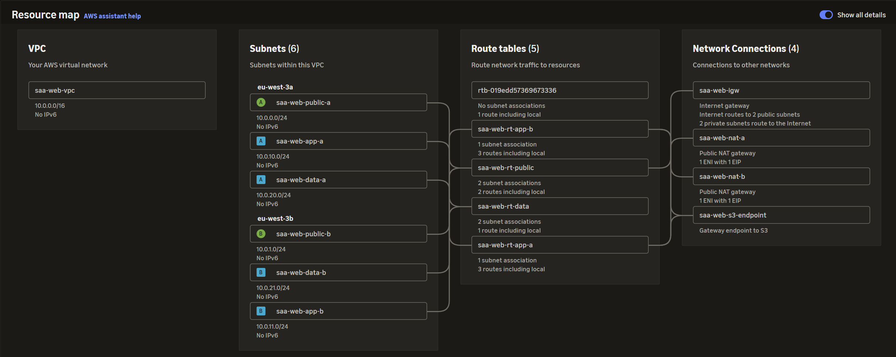
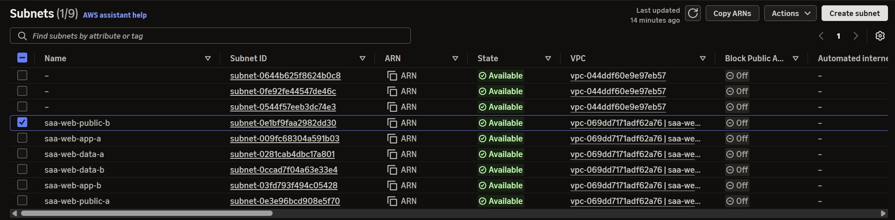
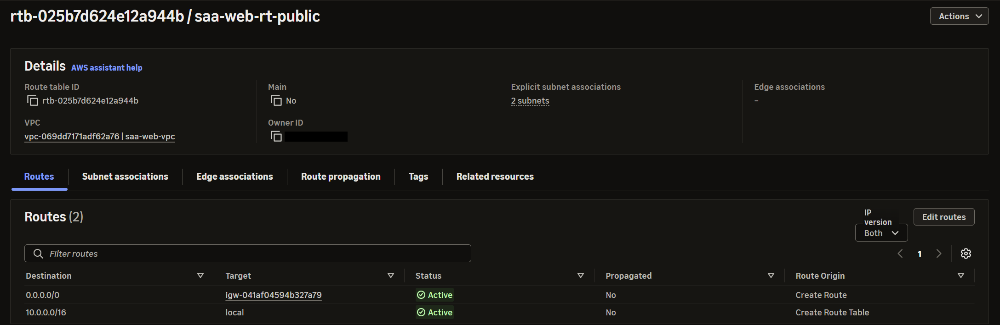
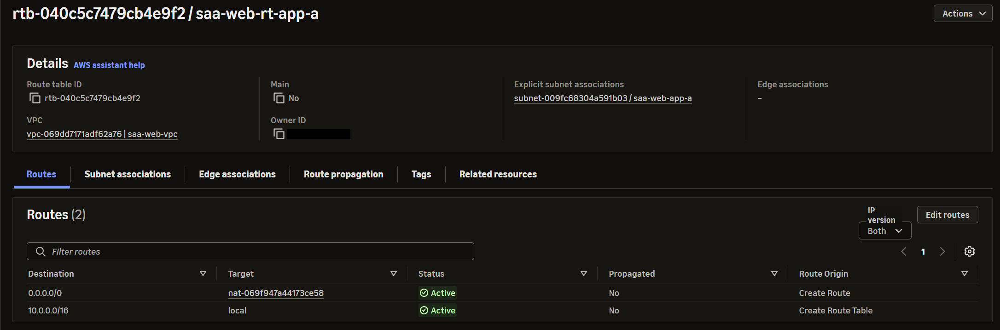
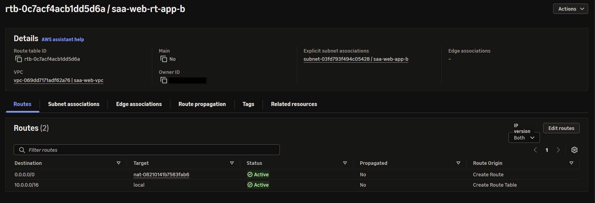
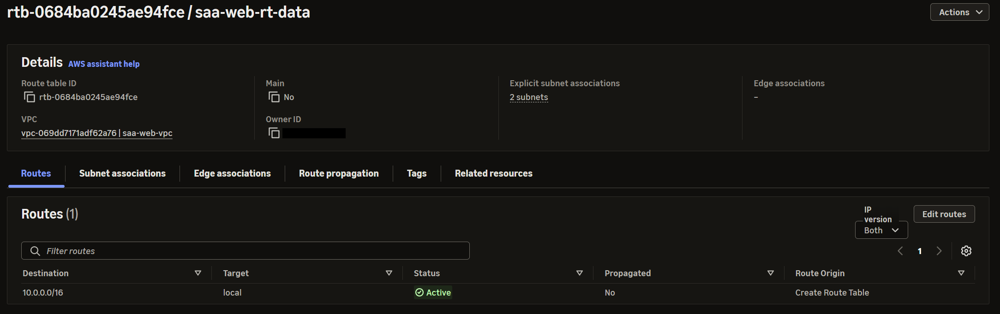
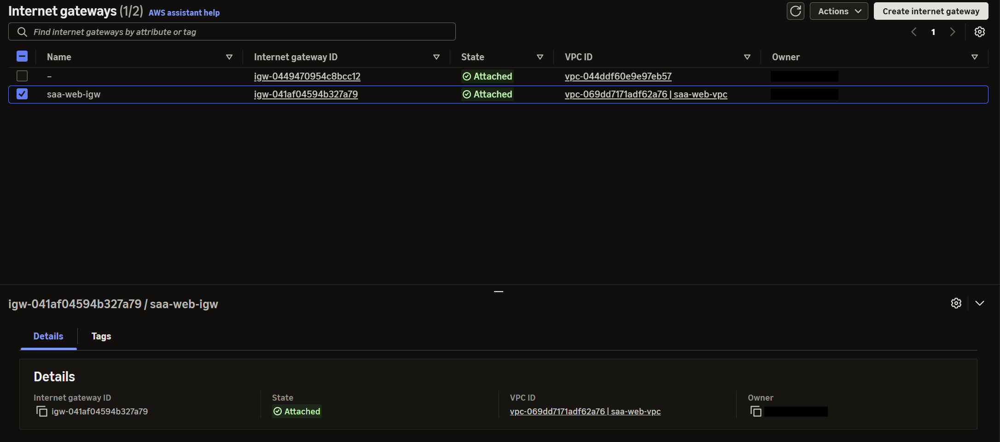
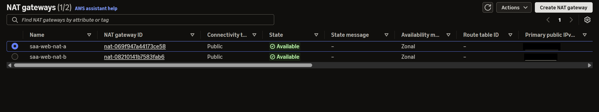
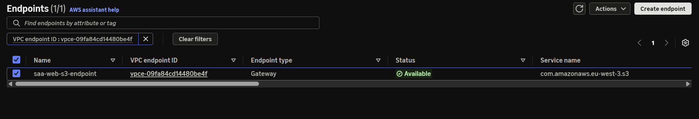

#### Issues

None encountered.

---

### 4.2 Security groups

#### What

Three security groups, all created in `saa-web-vpc` and chained so that each tier only trusts the tier in front of it:

| Group | Inbound | Outbound |
|---|---|---|
| `saa-web-alb-sg` | TCP 80 from `0.0.0.0/0` | Default (all traffic) |
| `saa-web-app-sg` | TCP 80 from `saa-web-alb-sg` | Default (all traffic) |
| `saa-web-db-sg` | TCP 5432 from `saa-web-app-sg` | None (default rule removed) |

#### Why

- **Chaining by group, not by CIDR.** The app group accepts traffic only from the load balancer's group, and the database group only from the app group. A CIDR rule would admit everything in the public subnets (the NAT Gateways, or anything added later), and it would not follow the ALB's addresses as it scales.
- **Port 80 only on the ALB.** The ALB is the single internet-facing component. There is no 443 rule because there is no domain and so no certificate, and an HTTPS listener cannot be created without one. HTTPS to viewers is provided by CloudFront's default domain (see 4.5).
- **Port 5432 for PostgreSQL.**
- **No outbound rule on the database group.** The database never initiates connections. Replies to allowed connections still work because security groups are stateful.
- **Outbound left open on the ALB and app groups.** This is a deliberate simplification. The app instances need HTTPS outbound for package downloads and Session Manager, and an open egress rule avoids debugging blocked traffic while building.

#### Screenshots

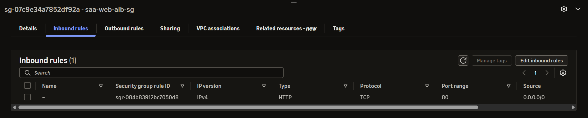
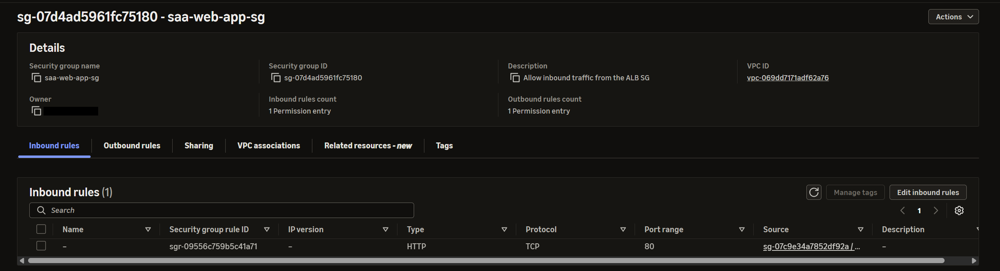
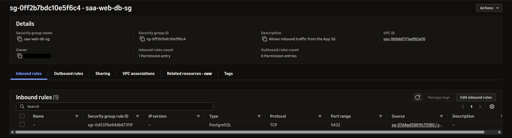

#### Issues

None encountered during creation.
---

### 4.3 Data layer

RDS Multi-AZ.

#### What

- **RDS for PostgreSQL** (engine version 18.3), instance identifier `saa-web-db`, Production template, **Multi-AZ DB instance deployment with one standby**.
- **Instance class:** `db.t3.micro` (2 vCPU, 1 GB RAM), with **gp3 storage, 20 GiB**, storage autoscaling disabled.
- **Encryption at rest** enabled with the default AWS-managed key (`aws/rds`).
- **DB subnet group** `saa-web-db-subgroup`, containing only `saa-web-data-a` and `saa-web-data-b`.
- **Network:** public access **No**, and only `saa-web-db-sg` attached.
- **Access:** master username `postgres` with a self-managed password. IAM database authentication not enabled.
- **Operations:** Database Insights in standard mode (7 days retention), enhanced monitoring disabled, PostgreSQL log exported to CloudWatch Logs, automated backups off, deletion protection off.

#### Why

- **Multi-AZ with one standby.** RDS keeps a synchronous standby in the other Availability Zone and fails over automatically. The application always uses a single endpoint name, so a failover needs no change on the app side.
- **Production template.** The free-tier template does not offer Multi-AZ, which is the point of this layer..
- **Self-managed password.** Simpler for a short-lived demo than Secrets Manager.
- **Deletion protection off.** It must be possible to delete the instance during cleanup.

#### Screenshots

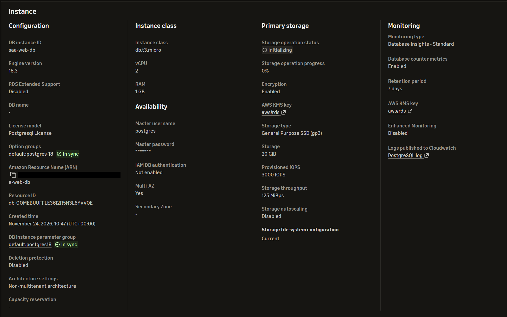
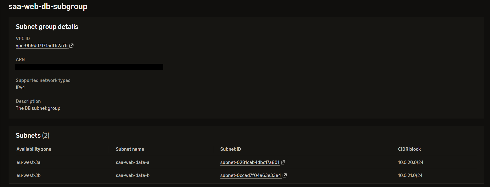

#### Issues

- **DB subnet group.** The console only offered "create new" for the subnet group, and I suspected an automatically created group would not be limited to the data tier. **Fix:** I created `saa-web-db-subgroup` by hand with only the two data subnets before creating the database, then selected it in the wizard.

---

### 4.4 Compute layer

Launch template and Auto Scaling group.

#### What

- **IAM role** `saa-web-ec2-ssm-role` for the EC2 service, with the AWS-managed policy `AmazonSSMManagedInstanceCore`, used through an instance profile.
- **Launch template** `saa-web-lt`: Amazon Linux 2023 (x86_64), `t3.micro`, security group `saa-web-app-sg` only, no key pair, no public IP, no subnet defined in the template, instance metadata set to **IMDSv2 only**, and the IAM instance profile attached.
- **User data** that makes every instance configure itself at first boot: it installs nginx and a PostgreSQL client, reads the instance's own ID and Availability Zone from the metadata service, writes a home page showing both, creates a `/health` path that returns 200, and creates a text file under `/static/`.
- **Auto Scaling group** `saa-web-asg` across `saa-web-app-a` and `saa-web-app-b` (balanced best effort):
  - Capacity: min 2, desired 2, max 4, attached to the target group `saa-web-tg`.
  - Health checks: EC2 and ELB, with a 300-second grace period.
  - Scaling: target tracking on average CPU utilization at 50%, with a 150-second instance warm-up.
  - Instance maintenance policy: launch before terminating, minimum healthy 100%, maximum healthy 150%.

#### Why

- **Everything is in the user data.** Instances are disposable. When the ASG replaces or adds one, it must come up fully configured without anyone logging in.
- **Role for Session Manager.** The SSM agent needs an identity to register with Systems Manager. I used an explicit instance role so the permission is visible in the architecture. Systems Manager's Default Host Management Configuration is an account-wide alternative that I did not use (see Improvements).
- **No subnet in the template.** The template says *what* to launch. *Where* is decided by the ASG, which spreads instances across the two app subnets.
- **Min 2, desired 2, max 4.** Two instances is the minimum that keeps one per AZ, so losing an AZ leaves a survivor. A maximum of 4 gives the scaling test room to grow while keeping cost low on micro instances.
- **ALB created before the ASG, ELB health checks from the start.** With ELB health checks, the ASG replaces an instance when the application stops answering, not only when the virtual machine fails.
- **300-second grace period.** It covers boot plus the package installs through the NAT. A shorter value risks replacing healthy instances that are still configuring themselves.
- **150-second warm-up.** A new instance's startup CPU spike does not count towards the group average until it has settled, which prevents unnecessary scale-out.
- **Launch before terminating (100% / 150%).** With only two instances, terminating first would briefly halve capacity. The 150% maximum is what allows an extra instance to exist during a replacement. The cost is that temporary extra instance.

#### Screenshots

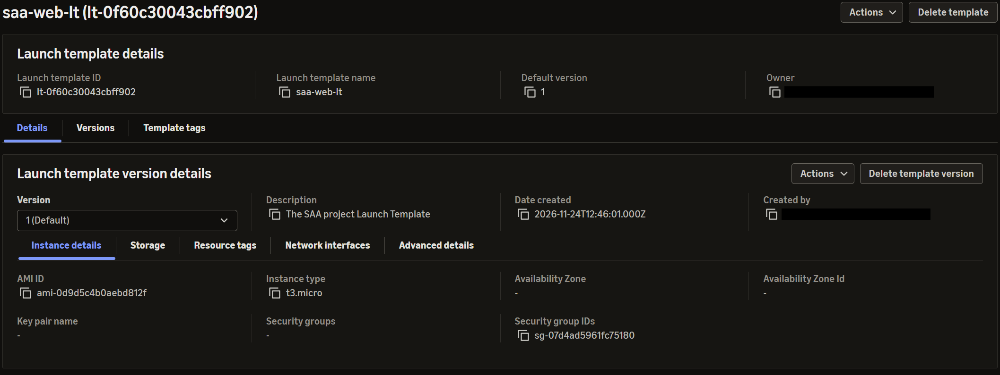
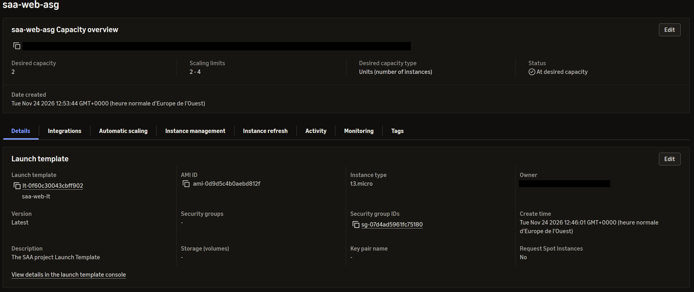
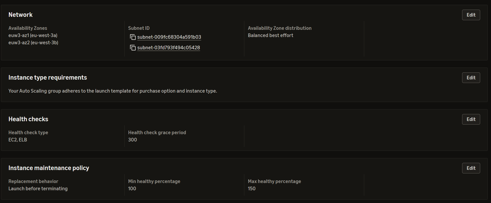
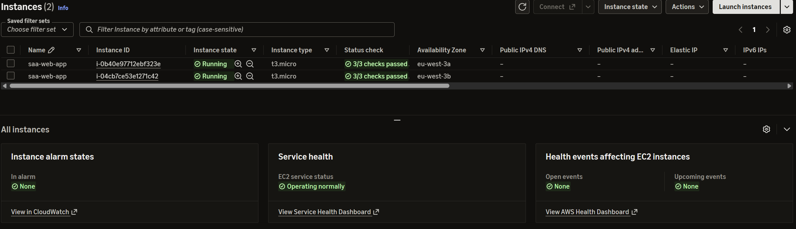
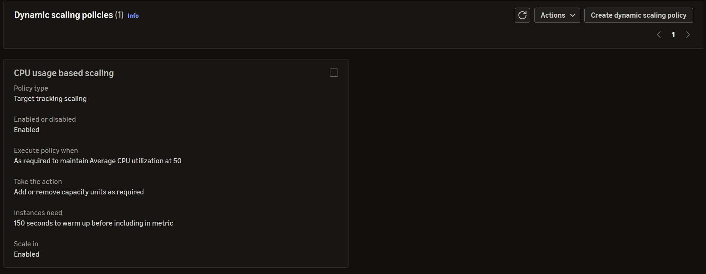
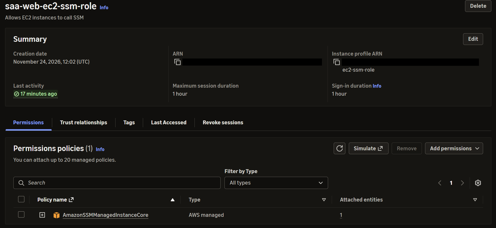

<!-- screenshots still to add: 19-asg-scaling-policy.png, 30-iam-ssm-role.png, launch template "Advanced details" tab (IMDSv2, instance profile, user data) -->

#### Issues

None encountered.

---

### 4.5 Load balancing and edge

ALB, WAF, CloudFront, Route 53.

#### What

- **Target group** `saa-web-tg`: instances, HTTP on port 80 in `saa-web-vpc`, health check on `/health` expecting 200, with shorter intervals and thresholds so instances become healthy quickly during testing. Targets are registered by the Auto Scaling group.
- **Application Load Balancer** `saa-web-alb`: internet-facing, placed in `saa-web-public-a` and `saa-web-public-b`, with `saa-web-alb-sg` only. One HTTP listener on port 80 forwards to `saa-web-tg`.
- **AWS WAF web ACL** `saa-web-acl`: regional scope in eu-west-3, associated with `saa-web-alb`. It contains two AWS managed rule groups, the Core rule set and the SQL database rule set. The default action is Allow, and the rule actions were left at their built-in values (block).
- **CloudFront distribution** `saa-web-cf` (Free plan, $0/month):
  - Origin: the ALB (type Elastic Load Balancing), protocol **HTTP only** on port 80, with no origin path.
  - `/static/*` behavior (precedence 0): viewers redirected from HTTP to HTTPS, cache policy `Managed-CachingOptimized`.
  - Default behavior (`*`, precedence 1): viewers redirected to HTTPS, cache policy `Managed-CachingDisabled`, origin request policy `Managed-AllViewer`.
  - No web ACL on the distribution (`TODO: confirm in the Security tab`).
- **Route 53 private hosted zone** `saa-web.internal` (standard, private, associated with `saa-web-vpc`):
  - Alias record `app.saa-web.internal` (type A) pointing to the ALB, with "evaluate target health" on. The NS and SOA records are created automatically.
  - Health check `saa-web-health`: HTTP against the ALB's DNS name on port 80, path `/`, status `Healthy`.

#### Why

- **ALB created before the ASG.** The ASG's ELB health checks need a target group attached to a real load balancer.
- **WAF on the ALB.** A security group only sees ports and addresses. WAF reads the content of HTTP requests, which is what detects SQL injection and script injection. The scope is regional because an ALB is a regional resource.
- **Managed rule groups, with built-in actions.** AWS maintains them and each rule already blocks by default. The Core rule set is the broad baseline, and the SQL database set targets injection. The default action is Allow, because a default of block would reject every visitor and the ALB's own health checks.
- **No web ACL on CloudFront.** Requests that CloudFront forwards to the origin still pass the ALB's web ACL. A cache hit is served from the edge and never reaches the ALB, so WAF does not inspect it. It is public static content, and AWS Shield Standard protects CloudFront at the network level. A CloudFront-scope web ACL is listed under Improvements.
- **Two behaviors.** The default path is not cached, so the home page always shows which instance and AZ answered. `/static/*` is cached with the managed `CachingOptimized` policy. The origin path is empty because nginx serves its files from the root. `/health` is only requested by the ALB itself and never goes through CloudFront.

#### Screenshots

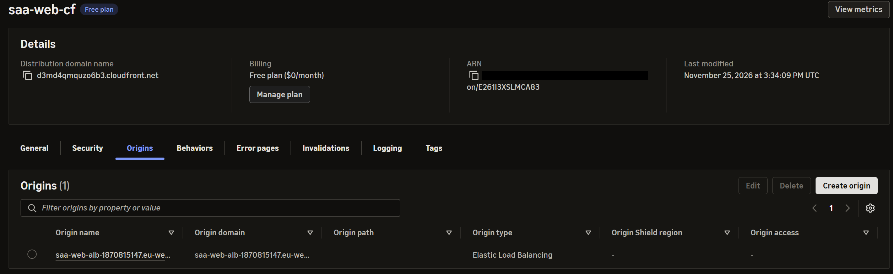
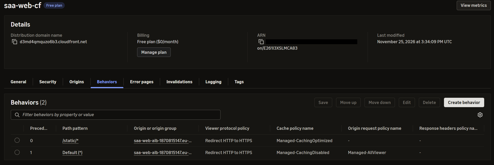
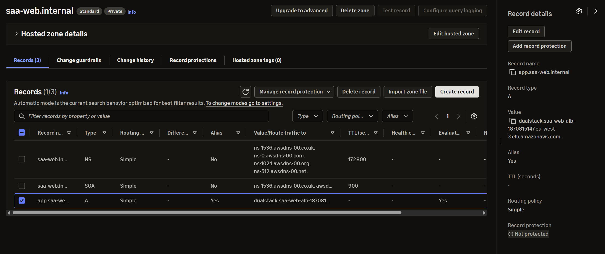
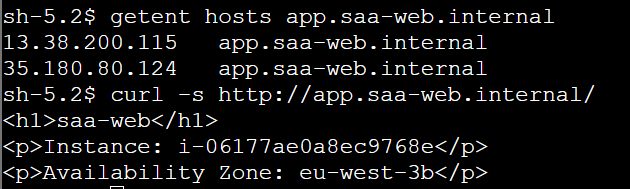
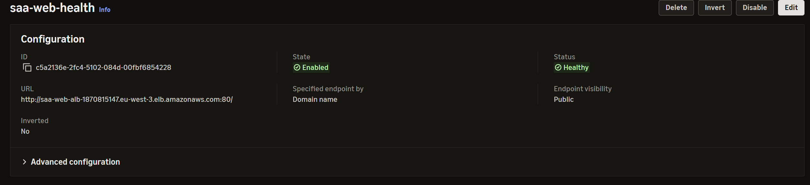
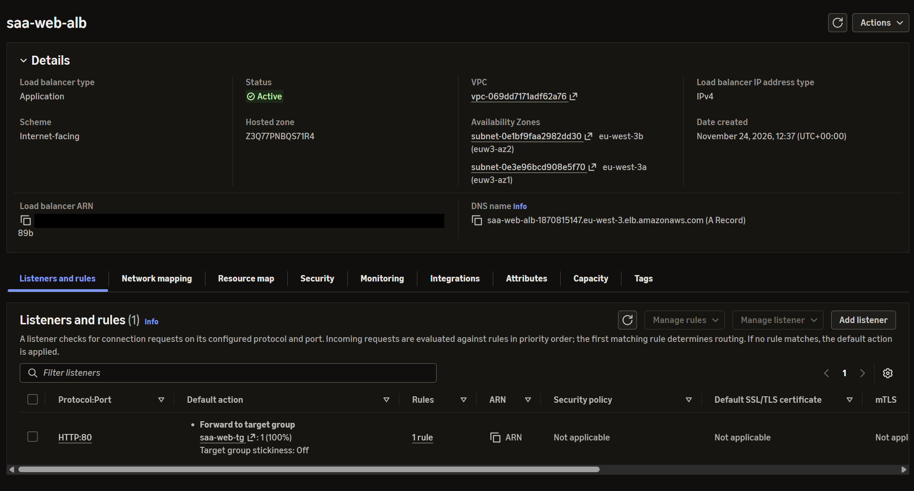
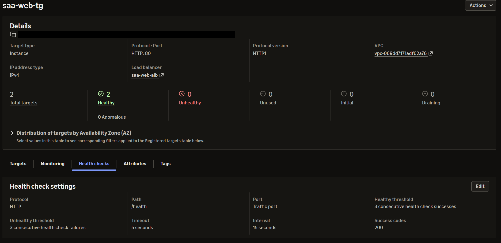

<!-- screenshots still to add: 21-alb-details.png, 22-alb-listeners.png, 23-target-group-health.png, 24-waf-web-acl.png, 25-waf-association.png -->

#### Issues

None encountered.

---

### 4.6 Access and observability

Session Manager, CloudWatch, SNS.

#### What

- **Session Manager access.** Admin access to the instances goes through Systems Manager Session Manager, using the instance role from 4.4. No key pair, no public IP and no inbound port are involved.
- **SNS topic** `saa-web-topic` (standard type, no encryption, default message size), with an email subscription that has been confirmed.
- **CloudWatch alarms**, all sending to the topic:

| Alarm | Metric | Threshold | Evaluation |
|---|---|---|---|
| Site down | ALB `HealthyHostCount` (minimum) | < 1 | 2 of 2 one-minute periods, missing data treated as breaching |
| Unhealthy instance | ALB `UnHealthyHostCount` | >= 1 | 2 of 2 one-minute periods |
| Fewer instances than planned | ASG `GroupInServiceInstances` | < 2 | 2 of 2 one-minute periods |
| Load balancer errors | ALB `HTTPCode_ELB_5XX_Count` | >= 5 | 2 of 2 one-minute periods, missing data treated as good |
| Request spike | ALB `RequestCount` (sum) | `TODO` (to recalibrate after the load test) | 2 of 2 one-minute periods |
| Sustained high CPU | ASG average `CPUUtilization` | > 80% | 2 of 2 five-minute periods |
| Low database storage | RDS `FreeStorageSpace` | < 2 GiB | 2 of 2 five-minute periods |

- **RDS event subscription** `saa-web-db-restart-event`, sending failover, failure and deletion events to the same topic.
- **CloudWatch dashboard** `saa-web-dashboard` with an alarm status widget and widgets for target health, request count, CPU, in-service instances, database connections and free storage.

#### Why

- **Session Manager over a bastion or SSH.** It needs only an outbound connection from the instance, leaves no port open, uses no keys, and logs sessions.
- **Alarms at group level, not per instance.** Instances come and go with the Auto Scaling group, so alarms attached to individual instances would break. Metrics are aggregated across both AZs because the question is whether the service is up, not which AZ is affected.
- **Database restarts and failovers as events.** These are not metrics, so an RDS event subscription is the right tool.

#### Screenshots

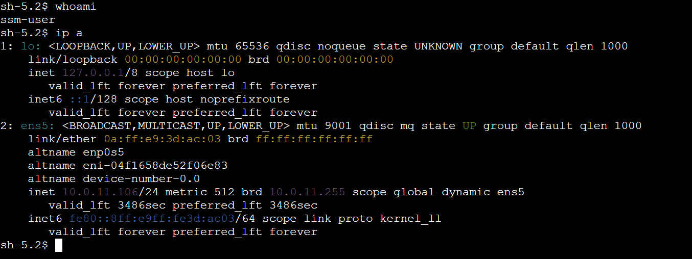
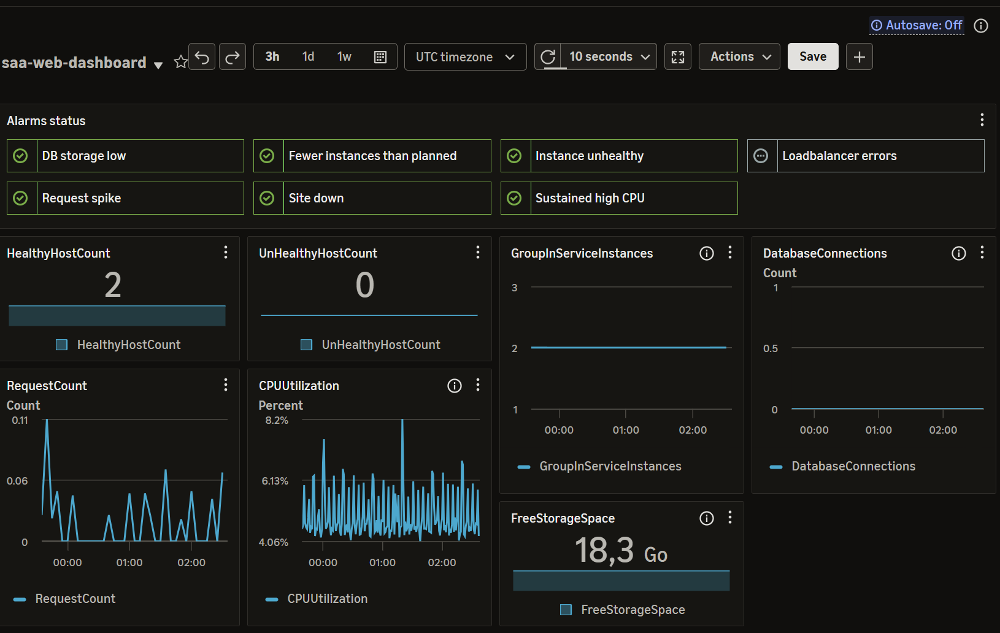
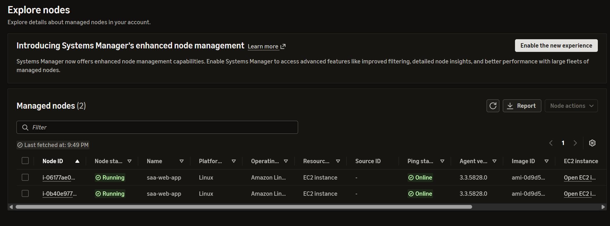

<!-- screenshots still to add: 31-ssm-managed-nodes.png, 34-cloudwatch-alarms.png, 35-sns-subscription.png, 36-alarm-email.png -->

#### Issues

None encountered.

---

## 5. Testing and validation

| # | Claim | How it was tested | Expected | Result |
|---|---|---|---|---|
| 1 | Traffic reaches both AZs | Reload the ALB's DNS name repeatedly | Responses alternate between instances in both AZs | **Passed.** One response came from instance `i-0b40e97712ebf323e` in eu-west-3a, another from `i-04cb7ce53e1271c42` in eu-west-3b |
| 2 | Failed instances are replaced | Terminate instance `i-04cb7ce53e1271c42` (eu-west-3b) | The ASG launches a replacement | **Passed.** The instance went from `Shutting-down` to `Terminated`, and the ASG launched `i-06177ae0a8ec9768e` in the same AZ, which later answered requests. Whether the site stayed up during the replacement: `TODO` |
| 3 | The database fails over | Reboot RDS with failover | Standby is promoted | **Passed.** The RDS events show the sequence "failover started", "DB instance restarted", "user requested a failover", "failover completed", all at 13:53 UTC on 24 Nov 2026. The endpoint name did not change. The application does not query the database, so reconnection of the app is not part of this test |
| 4 | WAF blocks bad requests | Send a script-like and a SQL-like query string to the ALB | Blocked requests | **Passed.** The web ACL activity shows the Core rule set blocking 1 of 4 requests and the SQL database rule set blocking 1 of 3, the rest passing to the default action (Allow). Response code seen by the client: `TODO` |
| 5 | Admin access needs no open port | Open a Session Manager shell | Shell opens, with no port 22 rule | **Passed.** The shell opens as `ssm-user` on an instance whose only address is private (`10.0.11.106`, in `saa-web-app-b`), and `saa-web-app-sg` has no rule other than port 80 from the ALB group |
| 6 | CloudFront caches static files | Request `/static/hello.txt` twice through CloudFront | `X-Cache: Hit from cloudfront` on the second request | **Passed.** First response `Miss from cloudfront`, second `Hit from cloudfront` with `Age: 9`, same edge location `MAD53-P7` |
| 7 | The private hosted zone resolves inside the VPC | `getent hosts app.saa-web.internal` and `curl` from a Session Manager shell | The alias resolves to the ALB and the page is served | **Passed.** The name resolved to two addresses (the ALB's nodes) and `curl` returned the application page from `i-06177ae0a8ec9768e` in eu-west-3b. The Route 53 health check shows `Healthy`. Lookup from outside the VPC: `TODO` |

Evidence:

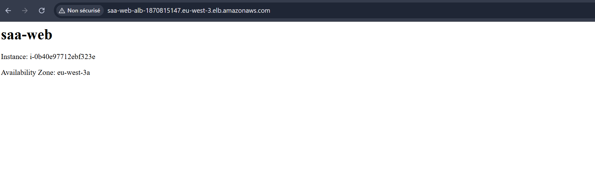
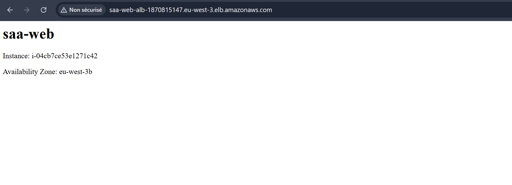
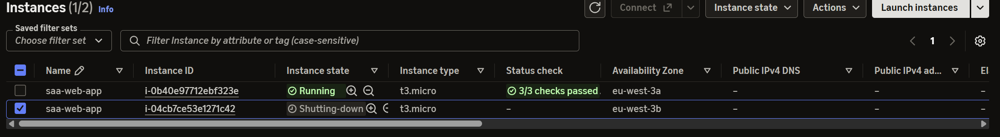
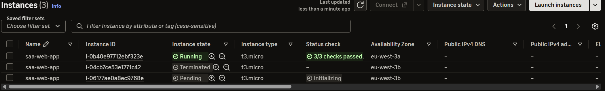
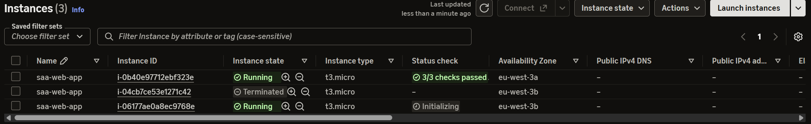
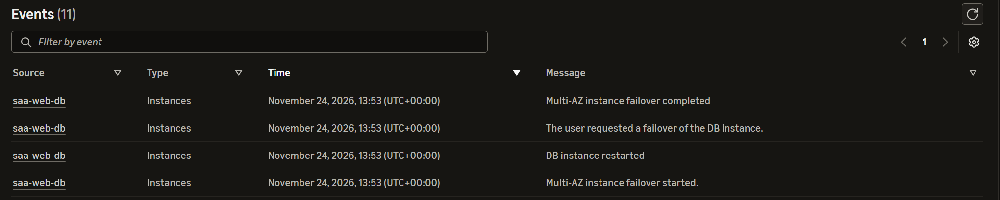
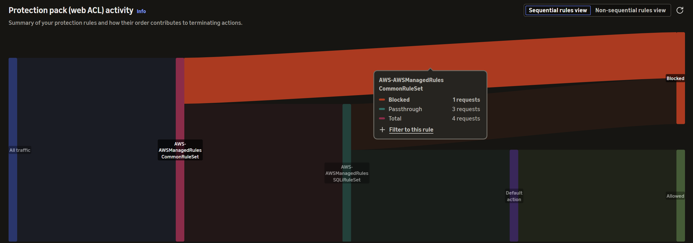
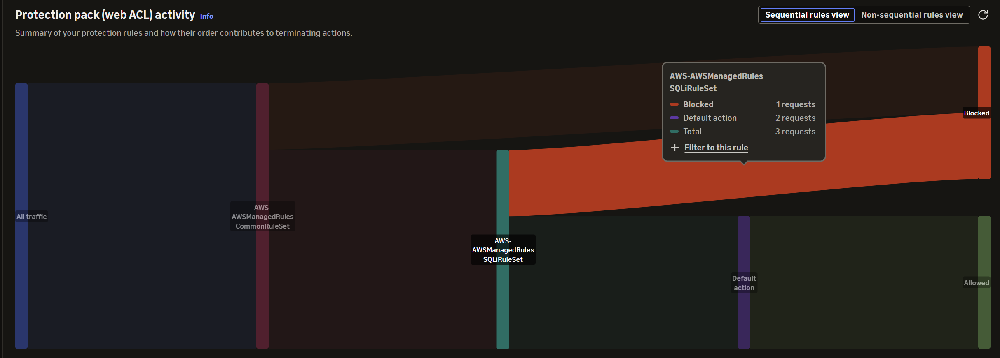
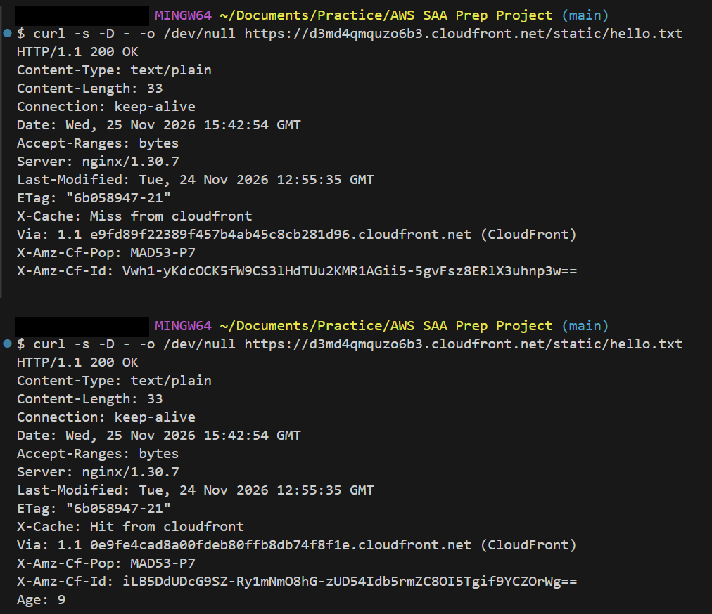

<!-- screenshots still to add: 39-test-scale-out.png (test 3), 41-test-waf-block.png (the 403 response) -->

---

## 6. Cost and cleanup

- **Estimated cost if left running:** roughly $3-4 per day (NAT Gateways, RDS Multi-AZ, ALB and public IPv4 addresses are the main items).
- **Cost controls used:** two AWS Budgets ($5 and $10), the smallest instance types, a CloudFront free plan, and a free S3 gateway endpoint.
- **Cleanup order:** Auto Scaling group, ALB (and its target group), CloudFront distribution (disable, then delete), WAF web ACL, RDS instance and its CloudWatch log groups, Route 53 records, health check and hosted zone, NAT Gateways (then release their Elastic IPs), S3 endpoint, remaining resources by the `saa-web-` prefix.

---

## 7. Improvements

- Infrastructure as code with Terraform for repeatable deploys and one-command teardown.
- A registered domain with ACM certificates, an HTTPS listener with an HTTP to HTTPS redirect, and end-to-end encryption between CloudFront and the ALB.
- An internal ALB behind CloudFront using a VPC origin, so the load balancer has no public address at all and the private name stays inside the VPC.
- S3 as the origin for static assets, with the ALB serving only dynamic content.
- A real application that uses the database, with the password in Secrets Manager and automatic rotation, plus automated backups with point-in-time recovery.
- Regional NAT Gateway mode to simplify routing, once its trade-offs are evaluated.